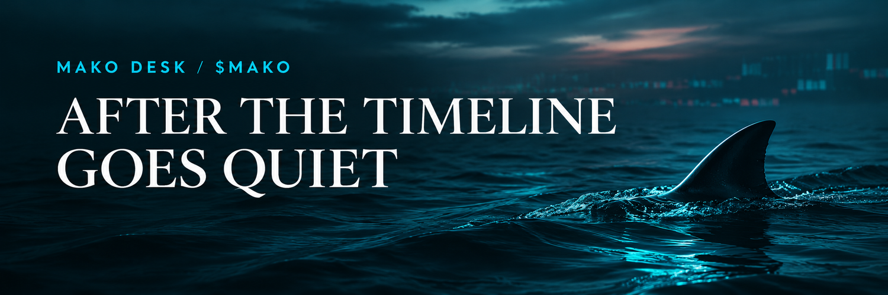
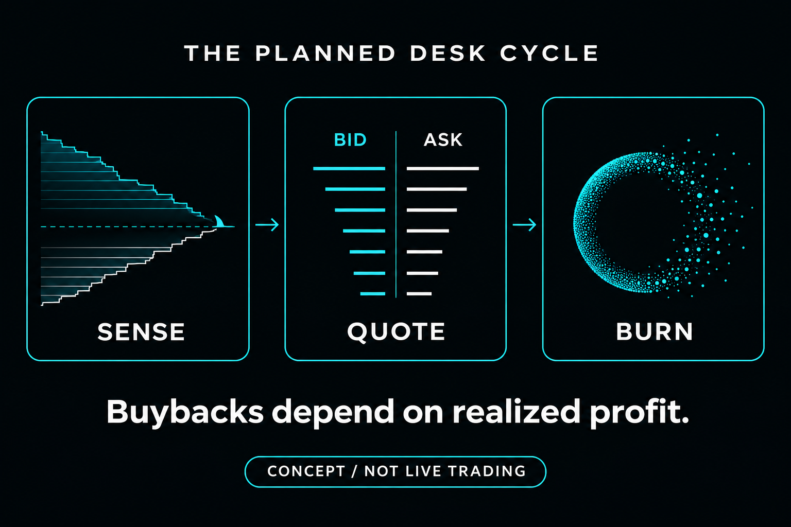
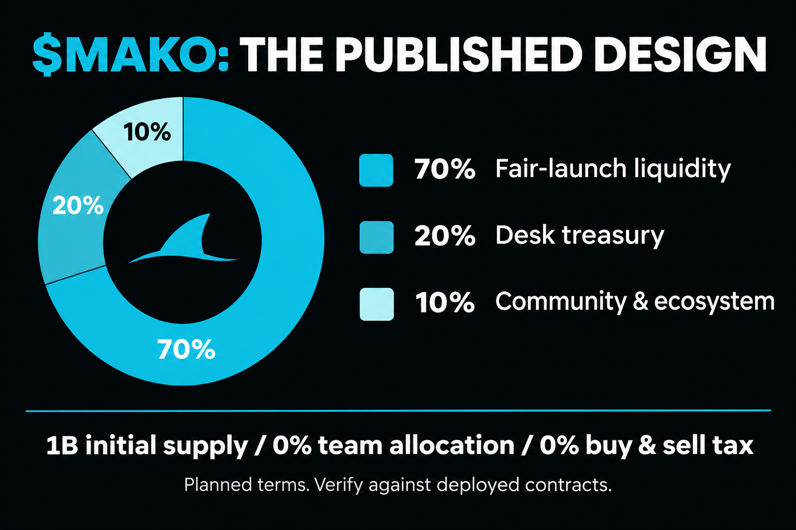

# After the Timeline Goes Quiet

*Mako Desk, $MAKO, and the work a memecoin could do after launch day.*

Picture a token launch with the sound turned off.

The chart still moves. Orders arrive, fill, disappear. Someone buys at the price another trader is willing to sell. Between those two people sits a small, easily overlooked part of the market: someone willing to quote both sides.

That job continues after the announcement has slipped down the timeline.

It is the job Mako Desk wants to give its shark.

Mako Desk is being built around a simple proposition: a memecoin can have a recognisable character and an operating mechanism worth watching. Its token is $MAKO. Its proposed mechanism is an on-chain market-making desk, with a share of realized trading profits used to buy back and burn the token.

There is an important detail at the start of this story. The current repository runs a simulated desk. Live trading, enforceable contract controls and actual buybacks belong to the implementation ahead. The preview lets people see the intended experience; it does not establish a trading record.

## A question the market keeps coming back to

In March 2024, Vitalik Buterin published a post titled *What else could memecoins be?* One line captures the opening he saw:

> “could there be a more positive-sum version of this whole concept?”

His discussion explored charity coins and meaningful games, asking what participants and communities might gain beyond speculation. [Read the post, March 29, 2024](https://vitalikblog.eth.1.w3link.io/general/2024/03/29/memecoins.html).

That question leaves room for different answers. Mako's proposed answer is a desk whose activity people can inspect: the orders it places, the inventory it holds, the losses it takes and any tokens it eventually burns.

A few months later, Buterin returned to the subject on X. As James Hunt reported in *The Block*, he wrote:

> “At least there was an actual show being funded.”

He was discussing Stoner Cats, a separate project, to explain why he wanted something tangible behind token activity. The useful question for Mako is similarly concrete: what work will the desk actually perform? [Read Hunt's article and the reported X remarks, June 5, 2024](https://www.theblock.co/news/ecosystems/2024-06-05-ethereum-co-founder-vitalik-buterin-unhappy-with-celebrity-memecoins-298624).

These references frame the wider debate. Neither Buterin nor the other people quoted here is being presented as an endorser of Mako Desk.

## The shark has a job description

Imagine a market maker posting a bid and an ask. A trader can sell into the bid or buy from the ask. If the market maker manages its inventory and execution well, it may earn a spread. If prices move against it, that inventory can lose money. Quoting both sides is work with risk attached.

Mako's documented design follows that pattern. The proposed desk reads market conditions, adjusts its quotes for inventory and risk, and places orders through a trading agent. The site calls the sequence **Sense, Quote, Burn**.

Hyperliquid's own documentation describes its order book as part of HyperCore. Mako's intended route to that infrastructure is through Elysium and the integrations described in the project's roadmap. The existence of HyperCore alone does not mean Mako's Elysium integration is ready. [Hyperliquid's order-book documentation](https://hyperliquid.gitbook.io/hyperliquid-docs/hypercore/order-book).

The shark's moods give this machinery a public face. Feeding, Hunting, Cruising, Circling and Breach are the project's labels for different conditions. Their value will come from helping people understand the desk's behaviour. A compelling animation is an introduction; recorded activity is the evidence.

## Where $MAKO fits

The published token design sets an initial supply of one billion MAKO. It specifies no further minting, no buy or sell tax and no team allocation.

| Planned allocation | Share | MAKO |
| --- | ---: | ---: |
| Fair-launch liquidity | 70% | 700,000,000 |
| Desk treasury | 20% | 200,000,000 |
| Community and ecosystem | 10% | 100,000,000 |

The documentation describes liquidity paired with HYPE and locked, desk inventory held by the MakoDesk contract, and a twelve-month linear unlock for the community allocation. These are published terms to verify against deployed contracts and lock records; the frontend configuration cannot prove them on its own.

The proposed link between the desk and the token is an 80% allocation of realized desk profit to buybacks and burns.

For a simple illustration, suppose a qualifying settlement period produced $1,000 of realized profit under the eventual accounting rules. The stated 80% policy would allocate $800 to that process. This is an explanation of the percentage, not a forecast. There may be no profit to allocate.

A burn would reduce supply. It would not guarantee demand, liquidity or a higher token price. Nor should readers confuse a buyback policy with a promised cash payment to holders.

## The difficult chapter matters most

Warren Buffett put it plainly in Berkshire Hathaway's 2001 shareholder letter:

> “you only find out who is swimming naked when the tide goes out.”

He was discussing insurance and exposure to other firms. The broader lesson travels well: favourable conditions can hide weaknesses that stress reveals. [Read the original letter](https://www.berkshirehathaway.com/2001ar/2001letter.html).

For a trading desk, that means the bad sessions deserve as much attention as the good ones.

Mako's documented safeguards include position limits, daily loss limits, a drawdown stop, a trading agent without withdrawal permission and a 48-hour delay on parameter changes. Those controls still need deployed implementation and verification. An audit is also on the roadmap.

The next credible chapter will therefore be practical: publish the contracts, verify permissions, connect the live reader, test the limits and build a public record. People should be able to follow a reported burn to its transaction and distinguish actual fills from preview data.

That is where this story gets interesting. A shark is easy to recognise. A desk takes longer to judge.

Mako Desk is building toward a point where someone can return after the launch conversation has faded, open the app, and see what happened while they were away: how the desk traded, where it lost, when it stopped and whether it earned anything to burn.

The fin gets your attention. The record has to earn the next visit.

Explore [Mako Desk](https://makodesk.xyz) and follow [@makodeskapp](https://x.com/makodeskapp) for project updates.
