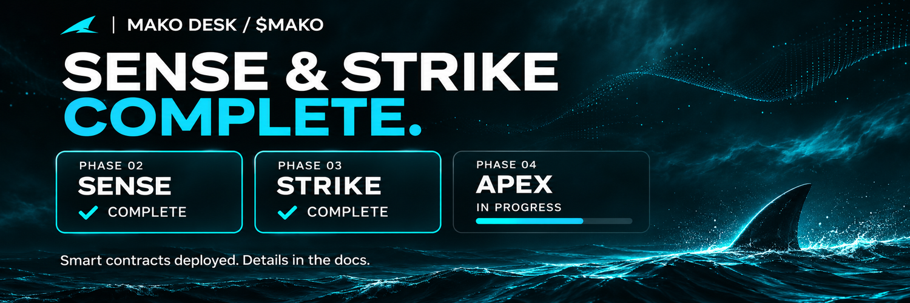

# Mako Desk: Sense and Strike are complete

The roadmap has moved forward. Phase 2 — Sense — and Phase 3 — Strike — are built, our development team has deployed the smart contracts, and the contract details are now in the docs.

For everyone who has followed $MAKO from the first preview, this is a milestone we've been working toward: bringing the market-reading tools and the desk's execution logic together.

Phase 2 covers the live Mood Engine, wick detection and real-time dashboard. These are the tools that turn market activity into something you can follow: changing conditions, sharp price moves and the desk's response.

Phase 3 brings the execution side: desk quoting under risk caps and the buyback-and-burn mechanism. The mechanism connects $MAKO to the desk's results, with 80% of realized desk profit allocated to buying back and burning tokens. That depends on the desk earning realized profit; it isn't a promised return.

With both phases built and the contracts deployed, our next chapter is Phase 4 — Apex. Work is already underway.

The focus now is building a public track record and working toward the next roadmap goals: a HyperCore spot listing, higher operating caps and a multi-market desk. Those remain goals in progress. We'll share updates as each one is delivered.

Thank you to everyone who has stayed close to the build, tried the app and asked the detailed questions. Keep asking them. The contract details are there to be read.

Read the [contract documentation](https://makodesk.xyz/docs#contracts) and follow [@makodeskapp](https://x.com/makodeskapp) for the next updates.

**Sense: complete. Strike: complete. Apex: in progress.**
